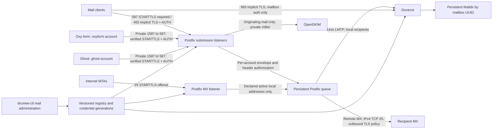

# Target architecture and protocol rules

The service is one independent Debian `mail` profile/project with three engines:
Postfix, OpenDKIM and Dovecot. The initial design is a single host, no HA promise.
An auxiliary `submission-policy` service, built into the same immutable Postfix
image, enforces originating header grants and credential generations. It uses
only the internal mail-control network and read-only applied registry projections;
it has no mailbox/spool/key mounts or Internet listener. Its control endpoint is
included in the exact network/service inventory and its failure tempfails
submission. MAIL-02 implements and tests this bounded policy, not a generic
user-supplied executable or configuration hook.
Shared host/disk/network outages remain shared failure domains; independence
means an **Oxy-form** lifecycle operation never stops/recreates the mail project.
Mail maintenance can affect all mail clients and needs its own maintenance plan.

## Network and ownership

| Boundary | Owner / allowed traffic | Explicitly excluded |
| --- | --- | --- |
| Public edge | Mail-owned routed bridge; Postfix 25/587/465 and Dovecot 993 only when enabled; Postfix outbound DNS and TCP25 | Host networking, Docker socket, arbitrary app/admin services |
| Private submission | Host binds mail-owned gateway address:1587 -> Postfix:587; allow only reviewed Oxy/Ghost source networks and operator test sources | CIDR-based relay authorization; attaching Ghost to an Infra-owned application network |
| Mail control | Internal bridge for Postfix -> OpenDKIM:8891 only; no published milter port | Internet/app/DB access, DKIM key mounts into Postfix/apps |
| Local delivery/auth | Shared **runtime socket directory**, recreated at boot: Postfix -> Dovecot LMTP and SASL Unix sockets | TCP LMTP/auth publication, sharing the whole Postfix spool with Dovecot |
| Durable state | Mail project owns registry, spool, mailbox root, key store, operator journal, backups; stable owner marker and host/mount identity | Oxy/Ghost stop, upgrade, rollback, cleanup or backup adopting these resources |

Private routing deliberately avoids shared Docker membership: clients reach a
host-bound endpoint from their existing egress networks. Proposed gateway
`172.30.250.1:1587` is **unallocated**. MAIL-04 must prove host routing, Docker
NAT/firewall enforcement, real source addresses, rejection from an independent
network and survival across either application's recreation. If the target
engine cannot enforce it, stop integration and revise the endpoint contract;
do not add a foreign network to bypass the existing exact-network guards.
New external mail dependency attestation excludes endpoint membership ownership.

Host operator/root controls the project. Dovecot master/login/auth have minimal
separate roles; mailbox workers use numeric `vmail` UID/GID (proposed 12001),
Postfix uses the image's fixed postfix/postdrop IDs, OpenDKIM a fixed unprivileged
ID. Exact numeric IDs are image-locked and recorded in resources. The operator
UID (proposed 12000) differs from mailbox worker UID. Root bootstrap may fix only
empty/new owned directories. No recursive chown of foreign/nonempty resources.
Registry and keys are 0700/0600; generated nonsecret config may be 0644 inside
protected owned trees. Dovecot sees mailbox data; Postfix never does. Mailbox
isolation uses fixed trusted userdb resolution to opaque IDs, no user-controlled
path expansion, master-user login, shared namespace or cross-mailbox ACL.

## Listener-specific Postfix policy

MAIL-02 must render separate `master.cf` service overrides and verify their
**effective** restrictions. One global listener policy is insufficient.

**MX/25:** `smtpd_tls_security_level=may`, no SMTP AUTH advertisement or SASL
enablement, `mydestination=` and `relay_domains=` empty; local domains are virtual
mailbox domains. `smtpd_relay_restrictions=reject_unauth_destination` with no
`permit_mynetworks` exception. Recipient checks include `reject_unlisted_recipient`
and authoritative active mailbox/alias maps. Unknown local recipient returns
`550 5.1.1` during RCPT; disabled receipt address `550 5.2.1`; registry unavailable
`451 4.3.0`. An external RCPT returns `554 5.7.1` regardless of client address.
No catch-all, backup MX relay, recipient callout to external sites or post-accept
unknown-user bounce. Null reverse-path from remote DSNs is accepted only to a
declared local recipient, under ordinary size/rate checks.

**Submission/587:** STARTTLS required, AUTH unavailable until TLS; without TLS,
`530 5.7.0`, without auth `530 5.7.0`, wrong password `535 5.7.8`. Enable Dovecot
SASL through Unix `auth` socket, mechanisms PLAIN/LOGIN only inside TLS. Mandatory
`permit_sasl_authenticated,reject` relay gate, with account eligibility and sender
checks **before** any generic authenticated permit can bypass them.
`smtpd_sender_login_maps` plus authenticated sender mismatch rejection enforce
exact envelope grants. No IP bypass, even loopback. **465** applies the same policy
with `smtpd_tls_wrappermode=yes`; plaintext/STARTTLS-only clients fail the TLS
handshake. Both require TLS >=1.2, no anonymous SASL or client-supplied authorization
identity impersonation. AUTH remains disabled on MX even for valid app accounts.

MAIL-02 implements a bounded before-queue originating policy/milter for header
authorization: exactly one RFC5322 From mailbox, matching the account's header
grant; Sender absent or the same authorized mailbox; reject duplicate/malformed
From/Sender, unauthorized envelope/author, null envelope and unapproved Resent
author headers on submission with `550 5.7.1`. Validate parsed addresses, not regex
over display names. Return 4xx if the policy is unavailable, before final DATA 250.
Client `Authentication-Results` is not trusted; remove forged locally authoritative
authentication headers. Recipient SMTP parameters must not bypass local address
validation. Bounded message/header size prevents resource exhaustion.

## Delivery, signing, TLS and failures

Postfix queue directory is persistent and private. Empty `relayhost`, no SMTP SASL
client credentials and no fallback smarthost: resolve recipient MX and connect on
25. DNS NXDOMAIN or null MX gives permanent routing failure; transient resolver/
network/4xx failures defer. Try alternate MX per native Postfix behavior. 5xx at a
recipient affects that recipient; retain other pending recipients. Queue expiry
creates a DSN. Remote 250 after DATA means the peer accepted responsibility, not
that the message was read. Lost acknowledgement is uncertain and may duplicate.

Default outgoing TLS is opportunistic `may`: encrypt when supported; no guarantee
of peer authentication or protection from downgrade, and native Postfix may retry
cleartext after a TLS negotiation failure. This is an explicit Internet SMTP
interoperability decision, distinct from always-verified submission. Operators
can select `required-verify` globally or for exact recipient domains: TLS, chain
and MX identity must verify or mail defers, with **no** cleartext fallback. No
automatic weakening after errors. DANE/MTA-STS enforcement is not promised in v1;
adding either requires resolver/policy cache/expiry/failure qualification.

Postfix routes declared local mailbox/alias addresses to an immutable mailbox
delivery identity (`mbx-<uuid>@local.invalid`) through generated transport/maps;
this internal-only namespace is not an Internet recipient or login address.
Userdb maps that identity to `/mailboxes/<uuid>/Maildir` and stable home/index
paths. Addresses stay separate from filesystem paths. Alias expansion is local,
one hop, to a live mailbox ID. Renames change the address mapping, not delivery ID.
Use `virtual_transport=lmtp:unix:/run/mail-sockets/lmtp` and a matching Dovecot
listener with mode 0600, owned by Postfix. Auth socket mode 0660 has only Postfix
and the Dovecot auth service; socket directory is shared tmpfs, not durable spool.
No external route to `local.invalid` is allowed through recipient maps.

Dovecot LMTP returns success **after** durable Maildir commit; Postfix retains
responsibility until its per-recipient LMTP 2xx. Quota plugin counts all mailbox
folders, including Trash and Sent, with count/index backend; no quota exemptions.
Both LMTP and IMAP APPEND/COPY/MOVE enforce quota. Quota-full LMTP is temporary
`452 4.2.2`, retaining mail in Postfix; if unresolved until queue expiry it produces
a DSN. Concurrent deliveries must not silently exceed quota; accounting is
reconciled after crash, and disk exhaustion fails temporarily before acceptance
where possible. Default 1 GiB/new mailbox, 10 MiB/message; administrative quota
reduction below use is permitted but reports `over_quota`, never removes mail.
Queue/disk pressure has separate high-water refusal/alert (MAIL-02 must define
and measure thresholds), so temporary quota refusal cannot fill the host silently.
Set quota storage grace and folder exceptions to zero explicitly: Dovecot 2.4's
default grace permits delivery beyond the nominal quota and is not acceptable
for this hard-limit contract. The lab discovered and corrected that difference.

IMAP is 993 implicit TLS only; 143, POP3 and ManageSieve are not published.
Mailbox login has no shell/system account, cannot choose another user's path,
and cannot use aliases to authenticate. Service=`imap` and service=`smtp` passdb
eligibility are separate. The SMTP-only `oxyform` and `ghost` accounts have no
userdb mailbox and fail IMAP login even with the correct password. No IMAP master
users or shared namespaces in v1. Local storage remains accessible to privileged
host administrators; this is account isolation, not protection from root.

OpenDKIM signs authenticated originating mail with `d=oxymot.fr`, selected active
selector and relaxed canonicalization; key is RSA >=2048 bits. Its failure on
submission tempfails before final acceptance. Inbound Internet mail is not
signed with the local key and never receives an originating trust macro merely
because its IP is internal. Inbound verification may report results but v1 does
not promise a complete spam/virus filtering system or DMARC enforcement pipeline.
Apply connection/message/account rate limits and disk alerts; forwarding, external
aliases, mailing lists and autoresponders are outside v1, limiting backscatter.

## Sender identities, DSNs and domain authentication

Proposed grants (owner approval before use): Oxy `forms@oxymot.fr` envelope/header;
Ghost `ghost@oxymot.fr` envelope/header; humans `contact@oxymot.fr` when submission
enabled. Oxy's current code uses a single configured sender for envelope and From,
so do not invent separate bounce addresses or Reply-To support during endpoint
migration. Provision local aliases `forms@` and `ghost@` to a monitored mailbox,
for example contact, so DSNs are received. `postmaster@` and `abuse@` must resolve
locally to monitored boxes before activation. Return-Path is inserted by the
receiving MTA from the envelope, not a user-supplied header. Postfix-generated
DSNs use null reverse-path and are not an SMTP login privilege; never bounce a DSN
to another DSN. Double bounces go to monitored postmaster, without a mail loop.

SPF must authorize the actual source IPv4 for envelope domains and the EHLO
hostname for null senders. DKIM `d=` and RFC5322.From align with `oxymot.fr`;
same-domain proposed envelope also aligns for SPF. Retain OVH/provider mechanisms
during dual operation; never publish a second SPF record. Recheck provider signer,
current return paths and DMARC policy using controlled recipient headers before
changing DNS. Ghost scope is transactional invitations/reset/security messages;
no newsletter/bulk delivery is added or qualified.

## Certificates and rotation

Use a publicly trusted certificate with SAN `mail.oxymot.fr` for public SMTP/IMAP
and the same verified server name for private clients even when connecting by IP.
Provided certificate renewal is mail-operator-owned: integrate the existing ACME
issuer via a protected export hook, not by mounting an HTTPS private-key tree.
Owner performs DNS challenge changes if needed; MAIL-01 issues no certificate.
Stage chain/key, verify SAN, validity, key match, permissions and fingerprints;
syntax-check both engines, atomically activate one certificate generation and
reload Postfix/Dovecot. Failed reload retains old usable generation and alerts;
before expiry or on compromise fail closed for new authenticated sessions.
Existing TLS sessions can retain the prior certificate until they end. Test actual
new connections to 25/587/465/993/private endpoint. Monitor expiry at 30/14/7 days.
Client CA changes precede server issuer changes, retain overlap, then remove old
trust after all clients rotate. DKIM rotation publishes new selector first, proves
DNS, switches signing, retains old public selector for maximum queue/retry and
receiver-cache window; never regenerates keys on restart or config rollback.

Primary design basis (checked during MAIL-01): [Postfix access controls](https://www.postfix.org/SMTPD_ACCESS_README.html),
[Postfix TLS policies](https://www.postfix.org/TLS_README.html),
[Dovecot SASL integration](https://doc.dovecot.org/2.4.3/howto/sasl/postfix.html),
[Dovecot LMTP integration](https://doc.dovecot.org/2.4.2/howto/lmtp/postfix.html),
[Ghost mail configuration](https://docs.ghost.org/config#mail).
These describe mechanisms; the lab/MAIL-02 evidence determines compatibility of
the exact pinned binaries and generated config.

## MAIL-02 Docker source-preservation amendment

Docker26 inter-bridge NAT hides client sources at the published gateway; disabling
masquerade alone is insufficient because bridge isolation then blocks the route.
Docker application clients therefore join the mail-owned frontal network as an
external network, retaining their independent backend networks. They use the
stable server address and hostname in `plan.private_endpoint`, without host DNAT.
The address is derived from the edge subnet and pinned in runtime preflight.
Private CIDRs apply to frontal source addresses; the gateway is denied and server
self-probes are separately allowed. TLS/auth/sender checks remain mandatory.
The canonical read-only Debian client descriptor creates no resource. Client
projects never own the mail network and mail joins no application backend.
Both earlier failed routes and the rationale are retained in Debian's
`profiles/mail/native/NETWORK-AMENDMENT.md`. Target integration remains MAIL04.
